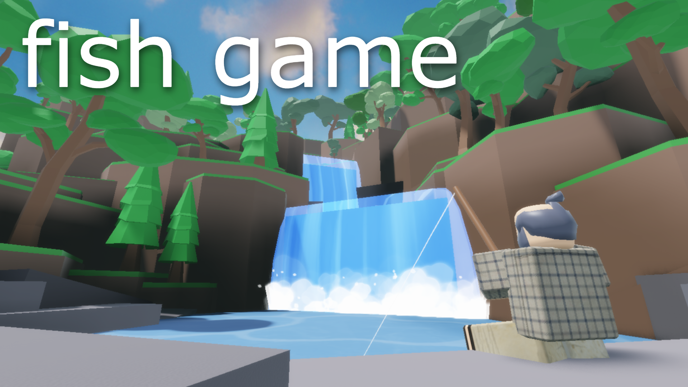
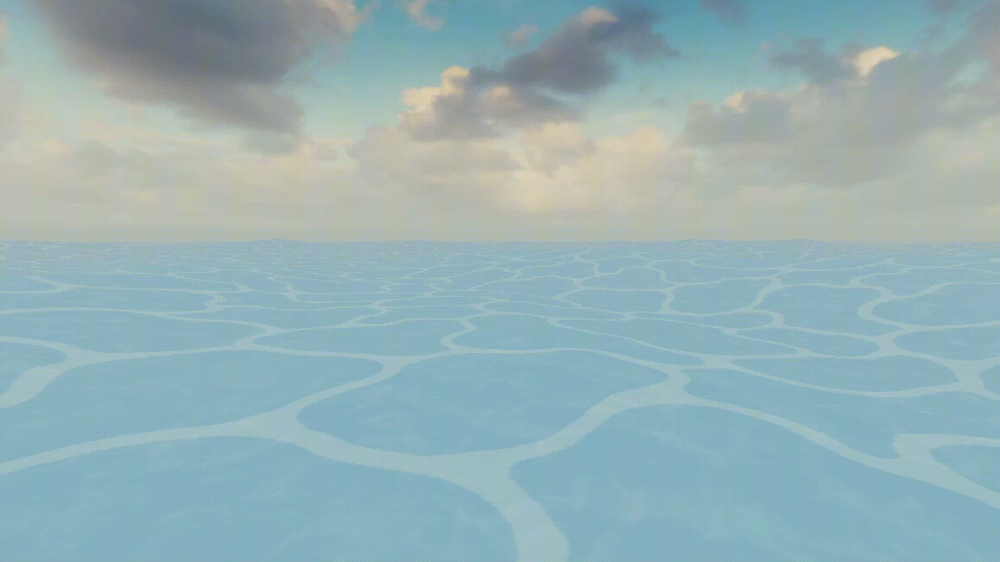
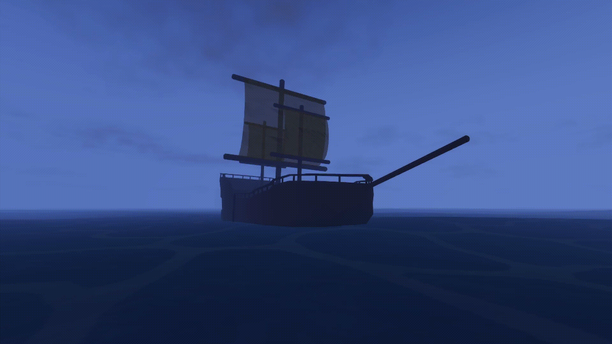
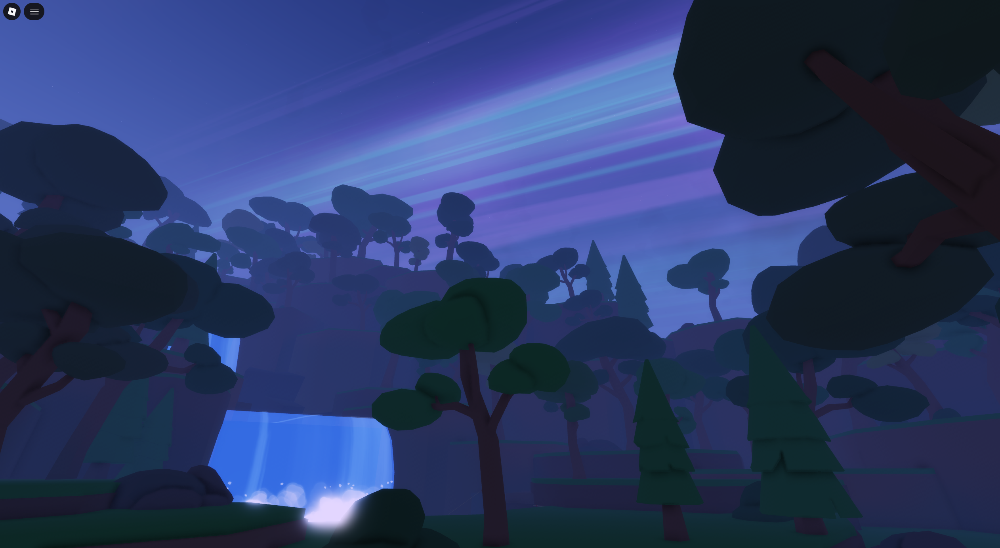

# Multiplayer Fishing Game

A multiplayer fishing game developed independently using Luau. The primary systems include: custom ocean simulation, boats, and dynamic world events.

## Overview

This is a showcase of the game's most major/interesting systems. Not all code is included.

## Highlights

### 1. Custom Ocean Simulation

This project uses a fully custom mesh-based ocean. The waves are animated by using perlin noise to determine water height at different positions. These wave positions are synchronized using server time, allowing clients to independently calculate the ocean's appearance.

Since standard raycasts cannot directly retrieve the height of the custom water surface, the system samples the mesh's bone triangles to estimate the water height at a given position.

**Selected source code:** [OceanSimulation.lua](Source/Ocean/Local/oceanMovement.lua)

### 2. Boat Physics

The boat system uses force-based movement and orientation constraints to control how boats move through the water. Buoyancy and drag forces allow responsive user control while interacting with the water's surface.

**Selected source code:** [BoatController.lua](Source/Boats/Local/boatControlsHandler.lua)

### 3. World Events

World events are server-wide events that increase player rewards and statistics for a limited time. They additionally alter the world's appearance for their duration.

**Selected source code:** [FishingController.lua](Source/Events/Server/worldEventHandler.lua)